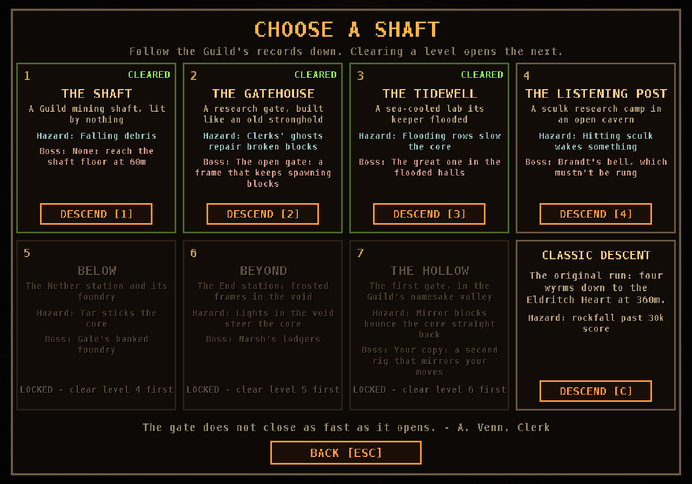
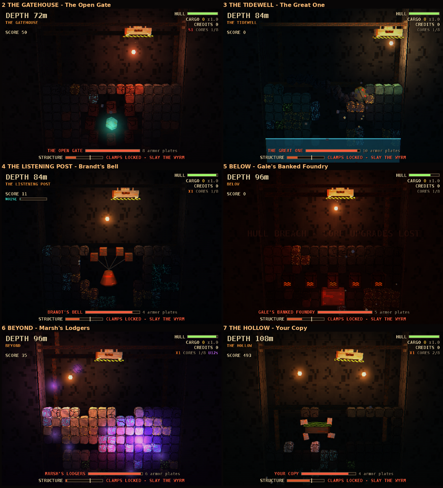

# Abyssal Breaker

A cave-miner × Arkanoid roguelite with a retro PS2 look. Your boring rig hangs over a lightless shaft and bounces the Wrecking Core, the only light down there, into the rock below. By **Kragnoth**.

This is the standalone Java port of the browser prototype ([SuperMineOut](https://github.com/kragnoth/SuperMineOut)), built on **LWJGL 3.3.3 + OpenGL 3.3 core + OpenAL**.

## Build and run

You need **JDK 21**. The Gradle wrapper downloads everything else.

```fish
# CachyOS / Arch
sudo pacman -S --needed jdk21-openjdk

./gradlew build                                              # compiles, runs the logic-sim tests, builds the fat jar
java -jar desktop/build/libs/abyssal-breaker-0.1.0-all.jar   # play
./gradlew :desktop:run                                       # or run straight from Gradle
```

The fat jar bundles LWJGL natives for Linux, Windows and macOS, so the same jar runs on all three. On macOS, add `-XstartOnFirstThread`.

### Launch options

| Option | Effect |
|---|---|
| `--fullscreen` / `--windowed 1920x1344` | window mode (F11 toggles in game) |
| `--demo` | the bot plays, menus included |
| `--level N` | start level N (1-7, 0 = Classic); with `--demo` the bot plays it |
| `--unlock-all` | open every level |
| `--boss 0..3` | jump straight to a wyrm in its biome (with `--level`, to that level's boss) |
| `--screen chest\|levels\|shop\|junction\|foundry\|over\|victory` | open a menu directly |
| `--shot FILE --shot-after SECONDS` | save a PNG of the window, then exit |

Saves go to `~/.local/share/abyssal-breaker/save.json` on Linux (or `$XDG_DATA_HOME`), `%APPDATA%\AbyssalBreaker` on Windows, and `~/Library/Application Support/AbyssalBreaker` on macOS.

## Controls

| Input | Action |
|---|---|
| Mouse / A D / ← → | move the rig |
| Scroll wheel / W S | lower or raise the rig on its spring |
| Click / Space | launch the core (or release held cores) |
| Right-click / E | release the clamps and drop |
| C / J / M / P | CRT+dither / vertex jitter / mute / pause |
| B / G | junction: bank / push on |
| 1-4, 5, R, Enter | workshop: buy card, repair, reroll, continue |
| K / P / 1-3 | tarot: keep / pass / replace |
| Space / Enter (title), 1-7, C, Esc | level select: open, pick a level, Classic, back |
| L | level select (game-over screen) |
| Q / Left Shift / MMB | fire gadget |
| 1-3 | take a chest or level-up card |
| F | Foundry (title and game-over screens) |

## Levels

The levels follow the depth bands in the *Gearwright's Hollow* pack bible. Clearing a level unlocks the next, and **Classic Descent** (the original four-wyrm run) is always open. **DESCEND** on the title screen opens the level select, where the bible's loading-screen lines rotate along the bottom.

| # | Level | Hazard | Boss |
|---|---|---|---|
| 1 | The Shaft | falling debris | none: reach the shaft floor at 60m |
| 2 | The Gatehouse | clerks' ghosts drift to broken cells and rebuild them; touch one with a core to dispel it | **The Open Gate**: a frame that keeps spawning blocks; break the 8 frame stones, then the gate |
| 3 | The Tidewell | the flood rises and falls; the turning tide pushes cores sideways | **The Great One**: a slow, huge wyrm in the flooded halls |
| 4 | The Listening Post | sculk seams: every hit adds noise; at 100, *it hears you* (hull damage, cores knocked down) | **Brandt's Bell**: break its 4 supports; striking the bell while it hangs rings it |
| 5 | Below | tar holds a core for half a second | **Gale's Banked Foundry**: 5 kilns vent fire up at the rig after a warning; kill the kilns, then the heart |
| 6 | Beyond | lights in the void pull passing cores off course | **Marsh's Lodgers**: six presences that wander and dive through the rig; the last shows itself |
| 7 | The Hollow | mirror blocks send the core straight back | **Your Copy**: an upside-down rig that mirrors your moves and bats cores back hard; break its 4 mirrors first |

Each level has its own block palette, fog and lighting, and adds new block types where the bible calls for them (sculk, tar, mirrors). Beating a level's boss offers **Surface** (bank everything, ×1.5 scrip) or **Endless** (the boss returns every 60m, stronger each lap).




## Chests, gadgets and rig levels

**Jackpot chests**, Vampire Survivors style. A chest is a gold-banded block buried in the rock. Chests also drop when a boss's armour breaks and when a Classic wyrm dies. If you go 12s without breaking anything, or spend 70s in one zone, the shaft *offers* a pity chest. A chest homes in on the rig and can't be missed. Opening one spins a reel: a plain chest gives **1 pick**, a gilded chest gives **3 picks** plus cargo, and a jackpot gives **5 picks** plus a pile of cargo. Each pick is one of three cards:
- a core upgrade for every core (a card is flagged when it would **complete an evolution**)
- a free workshop rank
- a gadget
- a hull patch or a cargo boost

**Gadgets** take one slot and are fired with **Q**, **Left Shift** or the **middle mouse button**. Taking the same gadget again levels it up (max 3), which shortens the cooldown and makes it stronger.

| Gadget | Effect |
|---|---|
| Seismic Charge | blasts open the rock face below the rig |
| Overdrive | cores smash through anything for a few seconds |
| Recall | snaps every core back onto the bumper to re-aim |
| Auger | fires 1-3 mega drills |

**Experience.** Broken blocks, ore and boss armour fill the purple bar across the top of the screen. Each **rig level** offers three perks. Basic perks are always available: Momentum, Chain Link, Hardened, Fortune, Scholar. **Combo perks** appear only once your build has what they need:

| Combo perk | Needs | Effect |
|---|---|---|
| Shrapnel | Blast | blasts crack 2 more blocks |
| Frag Cores | Fission + Blast | fission children detonate on first hit |
| Conductor | Arc + gadget | arc strikes recharge the gadget |
| Lightning Rod | Drill-Point + Arc | plowing dirt arcs to a neighbour |
| Kinetic Battery / Scrap Feed | gadget | bumper hits / ore pickups recharge it |
| Magnetar | magnet | falling cores bend toward the bumper |
| Lodestar | Prospector + magnet | gold ore homes in on you |
| Prism | panels | a laser crossing a core splits it |
| Rig Link | panels | Wall Rigs last twice as long, lasers fire faster |
| Slingshot | Catch / Recall | held cores launch faster and pierce 3 |
| Overclock | Overdrive | Overdrive also splits every core |
| Aftershock | Seismic Charge | the charge goes off twice |
| Feeder Drill | Drill Bay / Auger | mega drills leave a pod |

**Wall Rigs pod (L).** Bolts a laser panel and a magnet panel to the walls for about 14 seconds.

## What's in it

- **Spring rig** on a coil under a bridge trolley. Flick it down into a core for a **slam** (+35% speed, +2 damage).
- **Core upgrades** from pods, up to 8 per core, inherited by every split: Fission, Strength, Pierce, Blast, Arc, Prospector. **Evolutions** when two reach 2+: Storm, Drill Lance, Midas, Nova, Swarm.
- **Instant pods**: Mega Drill, Wide Rig, Magnet Surge, Catch, Hull Patch.
- **Wyrm bosses** at 80, 160 and 260 m, and **The Eldritch Heart** at 360 m, which wins the run. Then Surface, or go Endless.
- **Junctions** every 60 m: bank cargo, or push on for a multiplier.
- **Surface Workshop** (per run): Vampire Survivors-style offer cards with reroll and banish, wall panels (laser, skimmer), Grapple Bumper, Drill Bay and more.
- **The Foundry** (permanent): scrip upgrades with VS-style escalating prices, full refund, and achievement unlocks.
- **Tarot**: one Major Arcana card per lost rig, sometimes reversed. Keep up to 3 (each is active every run) or pass it for scrip.
- **Industrial audio**, synthesised at start-up: struck pipes, anvils, hydraulics and a machinery drone.

## Project layout

```
core/      pure-Java simulation, no rendering or audio dependencies (only Gson)
  Defs         every tuning constant and data table
  Game         world, physics, pods, evolutions, bosses, economy, Foundry, tarot, bot player
  Entities     plain state the renderer reads
  Fx           event sink for particles, sounds and messages
  SaveStore    JSON save, written atomically
  test/LogicSimTest   bot playthroughs that run during ./gradlew build
desktop/   LWJGL front-end
  render/      Renderer (GL 3.3 core), Geo, Textures (procedural), Particles
  audio/       Synth (offline synthesis), Audio (OpenAL)
  ui/          UiBatch (pixel-font atlas, 2D batch), Screens (HUD and menus)
  Main         window, input, game loop
```

## Logic-sim tests

`./gradlew build` runs `LogicSimTest`. It also plays every level six times with a mid-progress bot and fails the build if any run soft-locks. A bot with human-like reaction time and aim error plays 30 chained runs, spending scrip in the Foundry and resolving tarot cards between runs. The build fails on any exception, soft-lock (60 s without progress), or broken invariant (upgrade cap, core cap). The test also checks that the world-generation noise matches the browser build bit for bit. Run `./gradlew :core:test` to see the per-run log.

## Notes for a Minecraft port

- The LWJGL version (3.3.3) and JOML match Minecraft 1.21.1, and Gson is already on Minecraft's classpath.
- `core` has no rendering dependencies, so it can be dropped into a mod as-is. Implement `Fx` for particles and sounds, and `SaveStore` for wherever the save should live.
- The shaft is drawn as one cached mesh per row, rebuilt only when that row changes, much like Minecraft's chunk sections.
- The shaders are GLSL 330. Minecraft 1.21.1 runs a 3.2 core context, so they'd need `#version 150` and the minor syntax changes that come with it.
